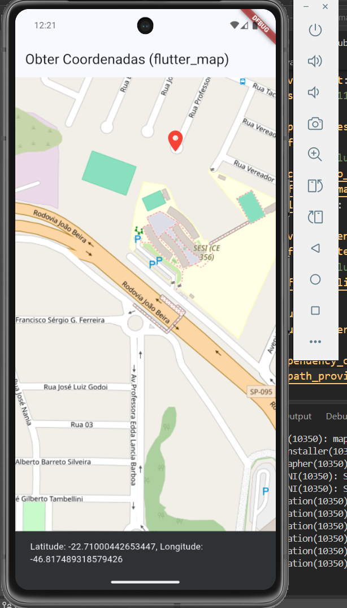

# Flutter Map - Aula 05

Projeto desenvolvido em Flutter para a atividade de Mapas do SENAI.

## Flutter Map Tutorial

O aplicativo utiliza o Flutter Map e o OpenStreetMap para exibir um mapa. Ao clicar em um ponto, são exibidas a latitude e a longitude do local selecionado.

## Funcionalidades

- Exibição do mapa
- Seleção de um ponto no mapa
- Marcador no ponto selecionado
- Exibição da latitude
- Exibição da longitude

## Tecnologias utilizadas

- Flutter
- Dart
- Flutter Map
- OpenStreetMap
- Latlong2

## Teste

Aplicativo testado no emulador Android.

## APK

O arquivo APK está disponível na pasta `assets` deste projeto.